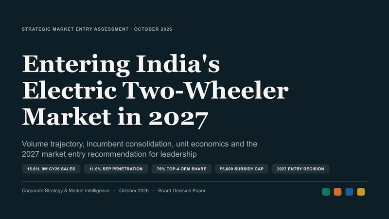
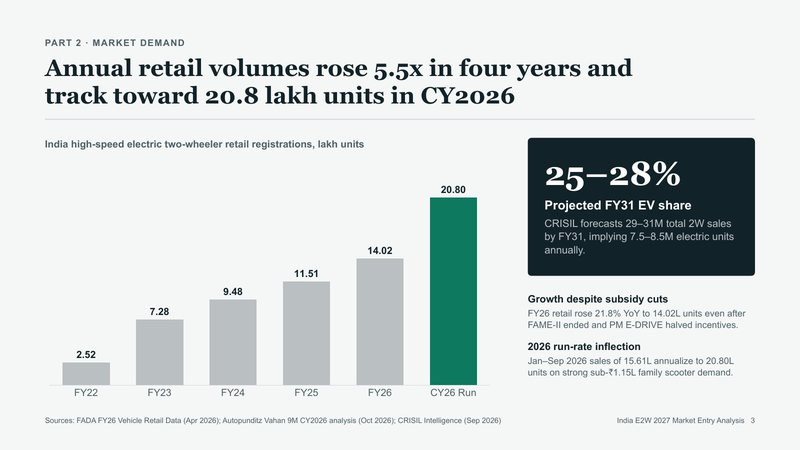
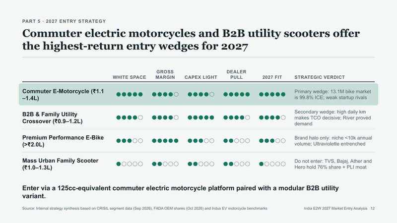
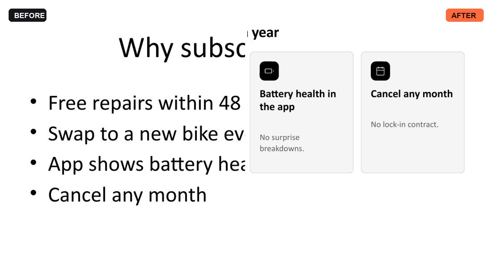
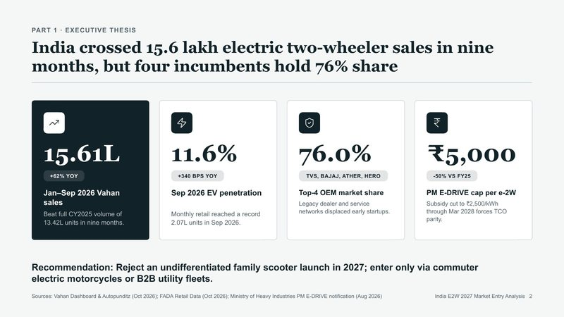
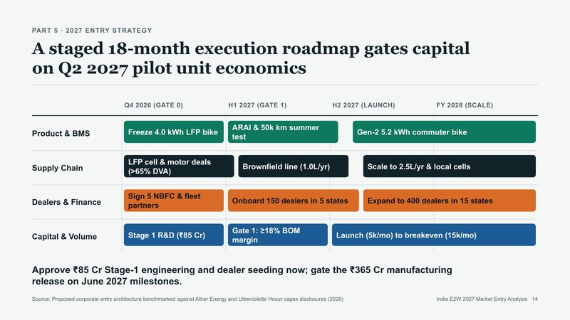

<p align="center">
  
</p>

<p align="center">
  <a href="https://siddharthrath1999.github.io/pptx-native/"><b>Website</b></a> ·
  <a href="#set-up">Set up</a> ·
  <a href="#how-it-works">How it works</a> ·
  <a href="#audiences-and-edits">Audiences &amp; edits</a> ·
  <a href="#examples">Examples</a> ·
  <a href="#better-prompts">Prompts</a> ·
  <a href="https://siddharthrath1999.github.io/pptx-native/prompts.html">Prompt gallery</a> ·
  <a href="#faq">FAQ</a>
</p>

<p align="center">
  <a href="https://github.com/siddharthrath1999/pptx-native/releases/latest"></a>
  
  
  
  
</p>

**PPTX Native** is a free, open-source skill for Gemini and Google Antigravity. Ask in one line. Get a researched, designed `.pptx` where every chart, table, icon and word stays editable in PowerPoint, Keynote, Google Slides and LibreOffice. Or hand it the deck you already have and say what to change.

<p align="center">  </p>
<p align="center"><sub>Three of the 15 slides Gemini built from one sentence in a real Task run, October 2026.</sub></p>

## Why it exists

Ask an AI for slides and you usually get one of three things. Each leaves the real work to you.

| What you get | Chat answer | Image-based tools | Quick exports | **PPTX Native** |
|---|:---:|:---:|:---:|:---:|
| A real .pptx file | ✗ | Images inside | Via conversion | ✓ |
| Every text box, shape and icon editable | ✗ | ✗ | ✓ | ✓ |
| Native charts with the data inside | ✗ | ✗ | Partly | ✓ |
| Researched, with sources on the slide | Partly | Partly | Partly | ✓ |
| Checks and looks at its own slides | ✗ | ✗ | ✗ | ✓ |
| Edits your existing deck, slide by slide | ✗ | ✗ | ✗ | ✓ |

<sub>Typical results. Individual tools vary.</sub>

## Set up

### Gemini app

1. Download **[pptx-native.zip](https://github.com/siddharthrath1999/pptx-native/releases/latest/download/pptx-native.zip)** (about 105 KB). Keep it zipped.
2. In Gemini, open **Customise** in the left menu, then the **Skills** tab.
3. Click **Create**, then **Upload**, choose the zip, and click **Create**.
4. Start a new chat, pick **Task** under the box, type `@pptx-native` and describe your deck.

You need a personal Google account (18+) and a **Google AI Pro or Ultra** plan, because the skill runs in Task mode. Upload from the Gemini website or Mac app. Task mode isn't offered in the EEA, the UK, Switzerland or Nigeria.

To update: open the skill, click **More**, then **Replace skill**, and upload the new zip.

### Google Antigravity

Paste one line into Terminal:

| System | Command |
|---|---|
| macOS · Linux | `curl -fsSL https://raw.githubusercontent.com/siddharthrath1999/pptx-native/main/install.sh \| bash` |
| Windows (PowerShell) | `irm https://raw.githubusercontent.com/siddharthrath1999/pptx-native/main/install.ps1 \| iex` |
| Any system with Node | `npx github:siddharthrath1999/pptx-native` |

The installer copies the skill to `~/.gemini/antigravity/skills/` and `~/.gemini/config/skills/`, installs `python-pptx` and `Pillow` if they're missing, and checks for LibreOffice (optional; with it, the agent can look at its slides). Add `--project` to install into `./.agents/skills` of the current project only. Restart Antigravity, then ask for a deck.

## How it works

One real request in Gemini's Task mode, start to finish:

> **@pptx-native** Make a 15-slide analysis of India's electric two-wheeler market for our leadership team, who must decide whether to enter in 2027.

| Step | What Gemini did |
|---|---|
| Research | Searched Vahan, FADA, CRISIL, EVreporter and PM E-DRIVE notices |
| Story | Planned five parts: thesis, demand, competition, economics, 2027 entry |
| Design | Made a custom executive-slate theme: Georgia headlines, Arial body, emerald and copper |
| Build | Built 15 slides with native charts, a table, a scorecard and a roadmap, then ran the checker |
| Check | Fixed text overflow on slides 3, 5, 6, 7 and 8 and an overlap on slide 14, rendered every slide, looked at them, and refined slides 9, 10 and 13 |
| Deliver | Handed over the `.pptx` with a note: 12 sources, nothing left to fill in |

Under the hood, Gemini writes the deck as a JSON spec and the bundled Python kit turns it into native slides. The kit checks every slide for cut-off text, overlaps, low contrast and stock AI phrasing; Gemini then renders the slides to images, looks at them and fixes what it finds.

## Audiences and edits

**It designs for who's in the room.** One company, four requests: the structure, slide types, wording and look all change, not just the colours.

<p align="center">   </p>
<p align="center"><sub>Board update, investor pitch, team workshop and product launch for Lumen Bikes, a fictional company. Sample data.</sub></p>

**It edits the deck you already have.** Attach a `.pptx` and say what to change. It reads every slide first, then changes only what you asked for, in your deck's own fonts and colours.

| You ask | It does |
|---|---|
| "Turn slide 2 into something better than bullets" | Rebuilds that slide with a kit layout, in your theme |
| "Change every FY25 to FY26" | Replaces the text on every slide, keeping formatting |
| "Update the chart with Q3 numbers" | Replaces the chart data; type and styling stay |
| "Add a decisions slide after the table" | Inserts a new slide that matches the rest |
| "Rewrite the speaker notes for investors" | Changes notes only |

<p align="center"></p>
<p align="center"><sub>Before and after: "Turn slide 2 into something better than bullets."</sub></p>

New and redesigned slides need a 16:9 deck. On other sizes it edits text, tables, charts and notes. New slides use the deck's theme colours and fonts, not its master artwork.

## Layouts

34 layouts, picked from the shape of your content: a number gets a big number, a ranking gets bars, a process gets steps.

| Data | Story | Flow | Teaching |
|---|---|---|---|
| Big number, KPI tiles, chart, chart pair, waterfall, bar list, split bar, table, heatmap, scorecard | Cover, agenda, section, statement, cards, comparison, two column, bullets, pros and cons, before and after, quote, next steps, sources | Timeline, process, funnel, 2x2 matrix, layers, roadmap, free canvas | Quiz question, runbook steps, code, recap |

## Examples

Four decks Gemini made with PPTX Native, each from a single sentence:

| Electric two-wheelers · market entry | How UPI works · learning deck | India's credit cards · analysis | Quick commerce · benchmark |
|---|---|---|---|
|  |  |  |  |
|  |  |  |  |
| 15 slides, 12 sources | 60 slides, 6 quizzes | 45 slides, 5 parts | 47 slides, 11 charts |

<sub>Made from online sources in October 2026. Figures have not been independently checked. Page through them on the <a href="https://siddharthrath1999.github.io/pptx-native/#examples">website</a>.</sub>

## Better prompts

**Clear beats long.** More context isn't better context: unrelated details pull slides off topic, and conflicting asks ("short but comprehensive") force guesses. Give the few things only you know, and leave research, structure and design to the skill.

1. **Say the job:** who it's for and what they should decide or learn.
2. **Give the source of truth:** attach the files that matter. One right document beats ten loosely related ones, and it outranks the web.
3. **Name the must-haves:** length, sections you need, things to avoid. Adjectives like "amazing" don't change the result.

| Long but unclear | Short and clear |
|---|---|
| Make a really good, detailed, professional, modern deck about EVs. Include everything: the history of cars, batteries, Tesla, China, policies, charging, startups. Make it look premium and colourful with lots of charts and keep it short but comprehensive. | Make a 30-slide analysis of India's electric two-wheeler market for our leadership team, who must decide whether to enter in 2027. Use the attached market report first. One slide per major brand, and end with a go or no-go recommendation. |
| No audience or decision; "everything" means no focus; short and comprehensive contradict | Audience and decision set the story; the source of truth is named; must-haves are specific |

Attach your files in the same message, and ask for changes in the same chat afterwards ("Make slide 12 a chart" rebuilds just that slide). The handoff note lists every source and any gap left as a placeholder like `[2025 revenue]`.

**[Prompt gallery →](https://siddharthrath1999.github.io/pptx-native/prompts.html)** 24 ready-made prompts for business and strategy, learning and training, product and tech, and editing decks. Each has fields you can change, a preview slide and a line on why it works.

## What's inside

| | |
|---|---|
| **Native charts** | Column, bar, stacked, 100% stacked, line, area, pie, doughnut, scatter and waterfall, with the data inside |
| **34 layouts** | From KPI tiles to roadmaps and quizzes |
| **Edits your deck** | Rewrite, update tables and charts, redesign or add slides, reorder, delete |
| **Researched and sourced** | Your files first, then primary sources; every data slide names its source |
| **Checks its own work** | Overflow, overlaps, contrast and wording, then a rendered review |
| **A look for every audience** | Nine starting styles, or your brand colours |
| **Speaker notes** | What to say on every slide |
| **152 icons** | Vector shapes, editable like any other |
| **100+ slides** | Parts, recaps and an appendix when you need depth |
| **Fonts that travel** | Looks the same on Windows, Mac, phones and Google Slides |

## FAQ

<details><summary><b>Is it really free?</b></summary>
Yes, it's open source under the MIT licence. In the Gemini app you need a Google AI Pro or Ultra plan, because it runs in Task mode. In Antigravity, your usual Antigravity plan applies.
</details>
<details><summary><b>Why does it need Task mode in Gemini?</b></summary>
Task mode gives Gemini a small computer where it can run the skill's tools. In normal chat it can't, so you'd get text, HTML or a Google Slides export instead of a .pptx.
</details>
<details><summary><b>Can I edit everything it makes?</b></summary>
Yes. Every text box, shape, chart and table is a normal PowerPoint object, and charts keep their data.
</details>
<details><summary><b>Are the numbers right?</b></summary>
It researches and cites sources, but it can still pick a weak source or misread one. Check figures before you present. The handoff note lists every source.
</details>
<details><summary><b>Can it use my brand?</b></summary>
Give your colours as hex codes in the prompt. Fonts default to ones every device has; ask for a brand font only if everyone presenting has it installed.
</details>
<details><summary><b>Does it add photos?</b></summary>
No. Visuals come from charts, tables, shapes and icons. Add your own photos afterwards.
</details>
<details><summary><b>Upload says "did not pass the security scan"</b></summary>
Upload the official zip, unchanged. If you edited files inside it, undo the changes and try again.
</details>

## Inside the repo

```
pptx-native/               the skill (this folder is what Gemini and Antigravity load)
  SKILL.md                 the workflow the agent follows
  references/              storylines, design directions, layout catalog, writing rules, editing
  scripts/build_deck.py    JSON deck spec -> .pptx, then lint
  scripts/edit_deck.py     inspect and edit an existing .pptx
  scripts/dk_*.py          layouts, themes, charts, tables, icons, text measuring, checks
  scripts/sheet_deck.py    contact sheets for visual review
  examples/gallery.json    a spec that uses every layout
install.sh · install.ps1   one-line installers for Antigravity
bin/install.js             the npx installer
docs/                      the website (GitHub Pages): index.html and prompts.html
```

Try the kit locally (Python 3.9+, `pip install python-pptx pillow`):

```bash
python3 pptx-native/scripts/build_deck.py pptx-native/examples/gallery.json -o gallery.pptx
```

## Licence

MIT. Icons in the skill are from [Lucide](https://lucide.dev) (ISC); see `THIRD_PARTY_NOTICES.md`. The website also uses Material Symbols (Apache 2.0).

PPTX Native is an independent project, not affiliated with or endorsed by Google or Microsoft. Gemini and Google Antigravity are trademarks of Google LLC. PowerPoint and its logo are trademarks of Microsoft.
