<p align="center">
  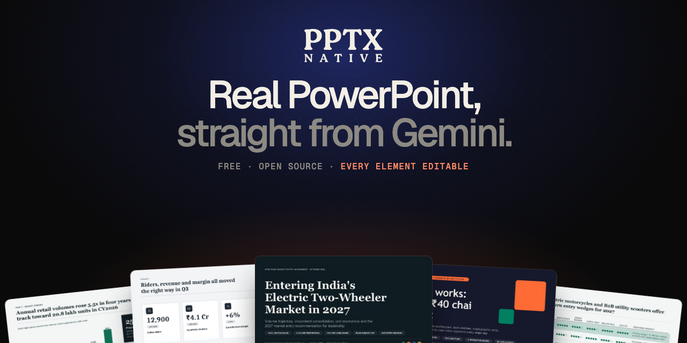
</p>

<p align="center">
  <a href="https://siddharthrath1999.github.io/pptx-native/"><b>Website</b></a> ·
  <a href="#install">Install</a> ·
  <a href="#how-it-works">How it works</a> ·
  <a href="#edit-a-deck-you-already-have">Edit a deck</a> ·
  <a href="#write-better-prompts">Prompts</a> ·
  <a href="https://siddharthrath1999.github.io/pptx-native/prompts.html">Prompt gallery</a> ·
  <a href="#examples">Examples</a>
</p>

<p align="center">
  <a href="https://github.com/siddharthrath1999/pptx-native/releases/latest"></a>
  
  
  
  
</p>

**PPTX Native** is a free, open-source skill for Gemini and Google Antigravity. Ask for a deck in one line. Gemini researches, writes, designs and checks it, then hands you a real PowerPoint file. Every chart, table, icon and text box stays editable in PowerPoint, Keynote and Google Slides. Already have a deck? Attach it and say what to change.

**Why it exists.** Ask an AI for slides and you usually get an outline in chat, pictures of slides you can't edit, or a quick export with generic layouts and charts to rebuild. PPTX Native builds a real .pptx with native charts, sourced research and speaker notes, checks every slide, and can edit your existing deck slide by slide.

<p align="center">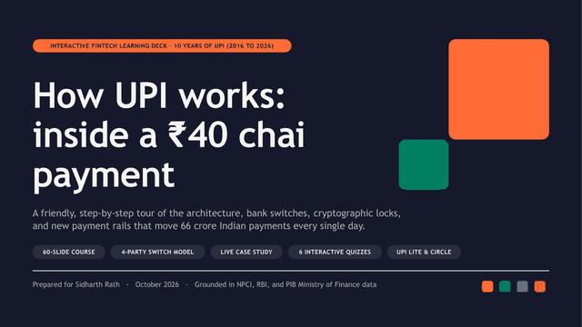</p>

## Install

### Gemini app (no install)

1. Download **[pptx-native.zip](https://github.com/siddharthrath1999/pptx-native/releases/latest/download/pptx-native.zip)**. Keep it zipped.
2. In Gemini, open **Customise** in the left menu, then the **Skills** tab.
3. Click **Create**, then **Upload**, choose the zip, and click **Create**.

You need a personal Google account (18+) and a **Google AI Pro or Ultra** plan, because the skill runs in **Task** mode. Upload from the Gemini website or Mac app. Task mode isn't offered in the EEA, the UK, Switzerland or Nigeria.

To update later: open the skill, click **More**, then **Replace skill**, and upload the new zip.

### Google Antigravity (one line)

Paste one line into Terminal:

| System | Command |
|---|---|
| macOS · Linux | `curl -fsSL https://raw.githubusercontent.com/siddharthrath1999/pptx-native/main/install.sh \| bash` |
| Windows (PowerShell) | `irm https://raw.githubusercontent.com/siddharthrath1999/pptx-native/main/install.ps1 \| iex` |
| Any system with Node | `npx github:siddharthrath1999/pptx-native` |

The installer copies the skill to `~/.gemini/antigravity/skills/` and `~/.gemini/config/skills/`, installs `python-pptx` and `Pillow` if they're missing, and checks for LibreOffice (optional; with it, the agent can look at its slides). Add `--project` to install into `./.agents/skills` of the current project instead. Then restart Antigravity and ask for a deck.

## How it works

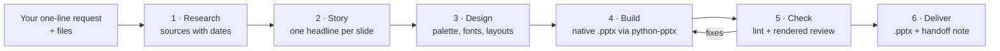

Gemini writes the deck as a structured spec. The bundled Python kit turns it into slides, then checks every slide for cut-off text, overlaps, low contrast and stock AI phrasing. Gemini renders the slides to images, looks at them, fixes what it finds, and delivers the file with a short note on assumptions, gaps and sources.

## Edit a deck you already have

Attach a `.pptx` in the same message and say what to change. PPTX Native reads every slide first, then changes only what you asked for, in your deck's own fonts and colours.

| You ask | It does |
|---|---|
| "Turn slide 2 into something better than bullets" | Rebuilds that slide with a kit layout, in your theme |
| "Change every FY25 to FY26" | Replaces the text on every slide, keeping formatting |
| "Update the chart with Q3 numbers" | Replaces the chart data; type and styling stay |
| "Add a decisions slide after the table" | Inserts a new slide that matches the rest |
| "Rewrite the speaker notes for investors" | Changes notes only |

<p align="center">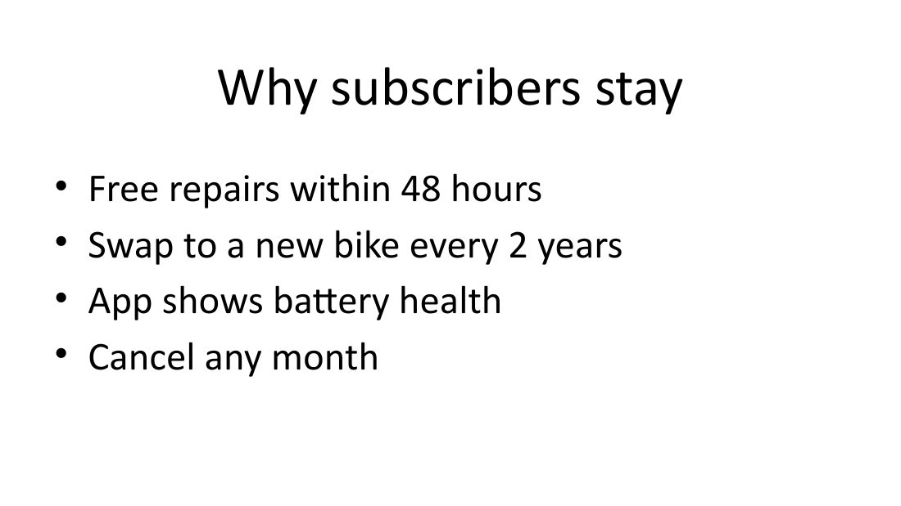 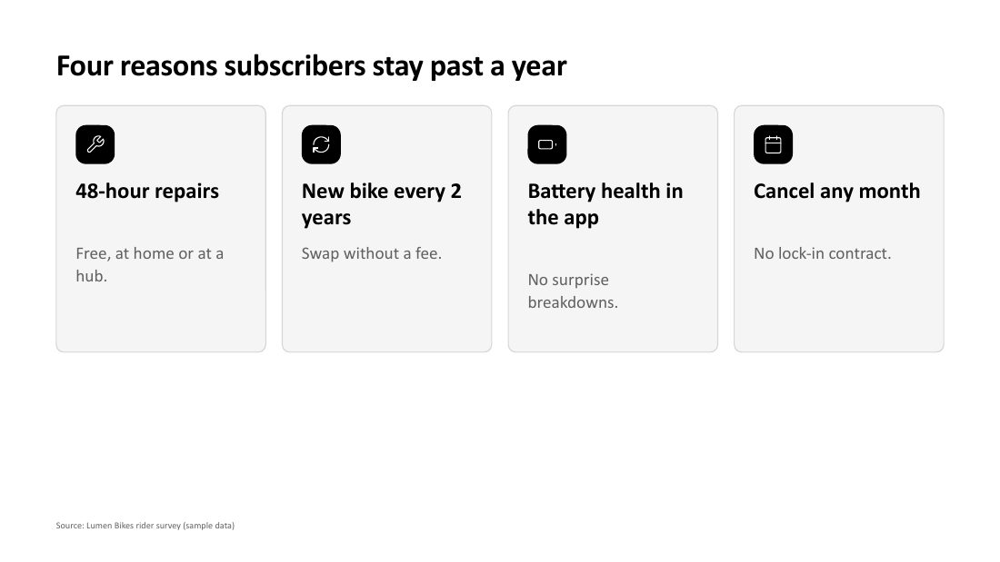</p>
<p align="center"><sub>Before and after: "Turn slide 2 into something better than bullets."</sub></p>

New and redesigned slides need a 16:9 deck. On other sizes it edits text, tables, charts and notes. New slides use the deck's theme colours and fonts, not its master artwork.

## What it makes

| | |
|---|---|
| **34 layouts** | Cover, agenda, KPI tiles, big number, cards, comparison, table, scorecard, heatmap, bar list, split bar, timeline, process, funnel, 2x2 matrix, layers, roadmap, runbook steps, quiz question, recap and more |
| **10 native chart types** | Column, bar, stacked, 100% stacked, line, area, pie, doughnut, scatter, waterfall |
| **9 starting looks** | Editorial warm, boardroom navy, executive slate, mono minimal, classic serif, dark tech, playful bright, soft pastel, bold contrast, or your own colours |
| **Edits your decks** | Rewrite, update tables and charts, redesign or add slides, reorder, delete |
| **Built for presenting** | Speaker notes on every slide, sources on data slides, 152 vector icons, decks of 100+ slides |
| **Works everywhere** | Fonts every device has, so the deck looks the same on Windows, Mac, phones and Google Slides |

<p align="center">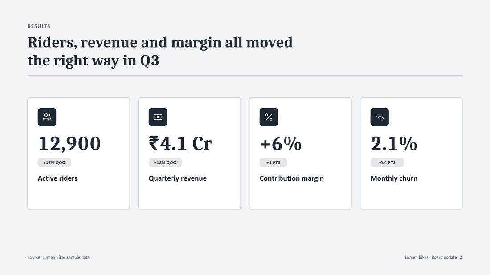 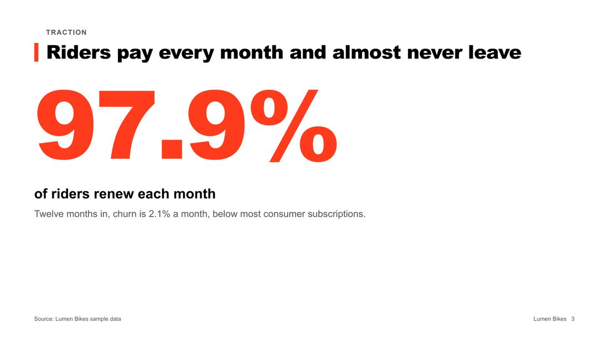 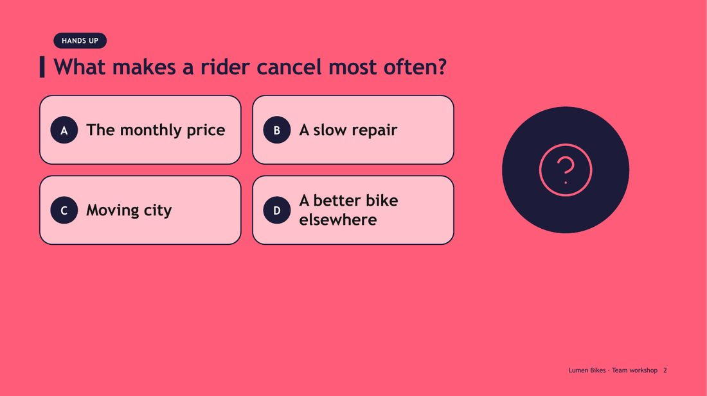 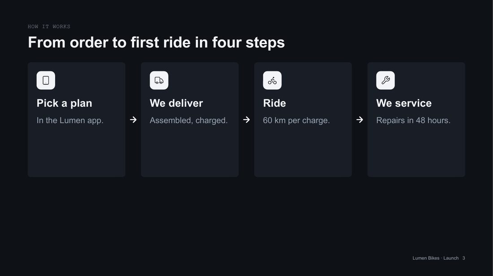</p>
<p align="center"><sub>One company, four audiences: a board update, an investor pitch, a team workshop and a launch. Structure, slide types and tone change, not just colours. Sample data.</sub></p>

## Write better prompts

**Clear beats long.** More context isn't better context: unrelated details pull slides off topic, and conflicting asks ("short but comprehensive") force guesses. Give the few things only you know:

1. **The job:** who it's for and what they should decide or learn.
2. **The source of truth:** attach the files that matter. One right document beats ten loosely related ones.
3. **The must-haves:** length, sections you need, things to avoid. Leave design to the skill.

> Make a 30-slide analysis of India's electric two-wheeler market for our leadership team, who must decide whether to enter in 2027. Use the attached market report first. One slide per major brand, and end with a go or no-go recommendation.

> Make a fun 30-slide learning deck that teaches college students how UPI payments work. Use one running story, quiz questions for the room, and simple language.

- **Attach files** (PDFs, sheets, notes) in the same message. Gemini uses them before the web.
- **Say the length.** Without one, an analysis runs about 40 to 80 slides.
- **Ask for changes after:** "Make slide 12 a chart" rebuilds just that slide.
- **Read the handoff note.** It lists gaps like `[2025 revenue]` and every source.

The [prompt gallery](https://siddharthrath1999.github.io/pptx-native/prompts.html) has 24 ready-made prompts for strategy, teaching, product and editing decks, with fields you can change before copying.

## Examples

Three decks Gemini 4 Argon made with PPTX Native from one-line requests:

| How UPI works · learning deck | India's credit card market · analysis | Quick commerce · benchmark |
|---|---|---|
| 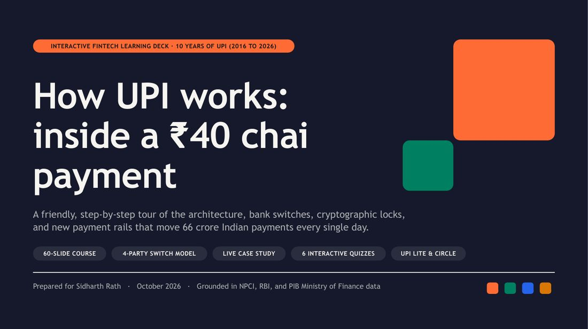 | 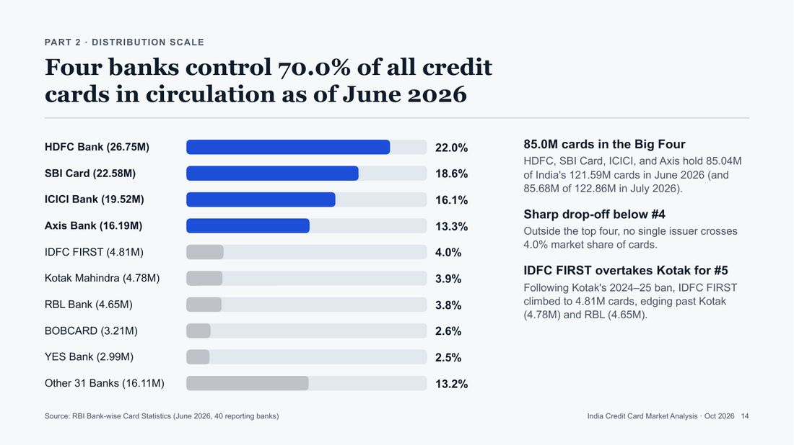 | 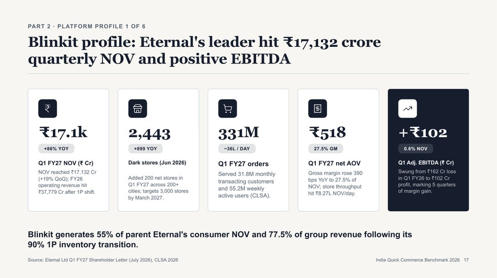 |
|  | 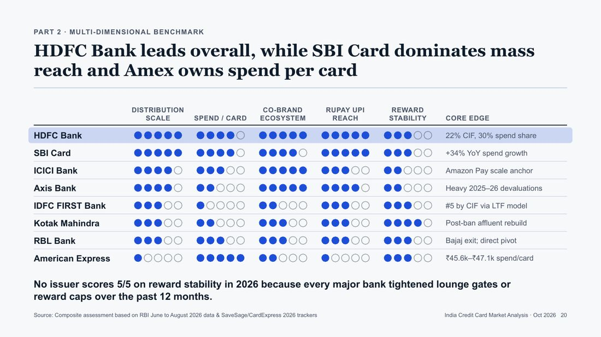 | 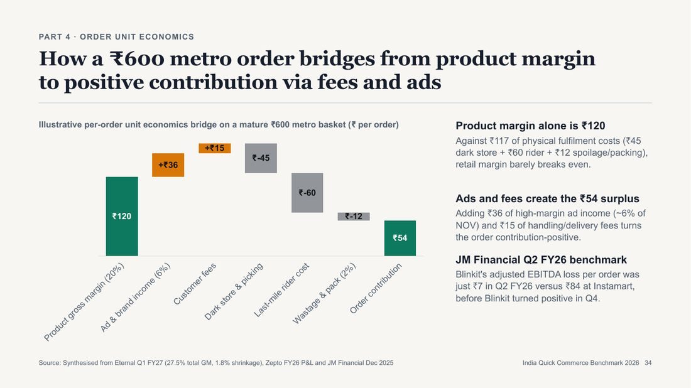 |
| 60 slides, 6 quizzes | 45 slides, 5 parts | 47 slides, 11 charts |

<sub>Made from online sources in October 2026. Figures have not been independently checked.</sub>

## FAQ

<details><summary><b>Why Task mode?</b></summary>
Task mode gives Gemini a small computer where it can run the skill's tools. In Chat mode you'd get text, HTML or Google Slides instead of a .pptx.
</details>
<details><summary><b>Are the numbers right?</b></summary>
Gemini researches and cites sources, but it can still pick a weak source or misread one. Check figures before you present.
</details>
<details><summary><b>"The uploaded file did not pass the security scan"</b></summary>
Upload the official zip, unchanged. If you edited files inside it, undo the changes.
</details>
<details><summary><b>Can it edit a deck I already have?</b></summary>
Yes. Attach the .pptx and say what to change. See <a href="#edit-a-deck-you-already-have">Edit a deck</a>.
</details>
<details><summary><b>Does it add photos?</b></summary>
No. Visuals come from charts, tables, shapes and icons. Add your own photos afterwards.
</details>

## Inside the repo

```
pptx-native/               the skill (this folder is what Gemini and Antigravity load)
  SKILL.md                 the workflow the agent follows
  references/              storylines, design directions, layout catalog, writing rules
  scripts/build_deck.py    JSON deck spec -> .pptx, then lint
  scripts/edit_deck.py     inspect and edit an existing .pptx
  scripts/dk_*.py          layouts, themes, charts, tables, icons, text measuring, checks
  scripts/sheet_deck.py    contact sheets for visual review
  examples/gallery.json    a spec that uses every layout
install.sh · install.ps1   one-line installers for Antigravity
bin/install.js             the npx installer
docs/                      the website (GitHub Pages)
```

Try the kit locally (Python 3.9+, `pip install python-pptx pillow`):

```bash
python3 pptx-native/scripts/build_deck.py pptx-native/examples/gallery.json -o gallery.pptx
```

## Licence

MIT. Icons in the skill are from [Lucide](https://lucide.dev) (ISC); see `THIRD_PARTY_NOTICES.md`.
PPTX Native is an independent project, not affiliated with or endorsed by Google or Microsoft. Gemini and Google Antigravity are trademarks of Google LLC; PowerPoint is a trademark of Microsoft.
